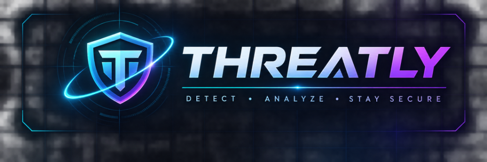

<p align="center">
  
</p>

<h1 align="center">THREATLY</h1>
<p align="center"><strong>Detect · Analyze · Stay Secure</strong></p>

<p align="center">
  <a href="https://github.com/Akulverma2/THREATLY/actions"></a>
  <a href="#"></a>
  <a href="https://nextjs.org/"></a>
  <a href="https://react.dev/"></a>
  <a href="https://www.typescriptlang.org/"></a>
  <a href="https://threatly-tawny.vercel.app"></a>
</p>

---

## 🛡️ What is THREATLY?

**THREATLY** is a production-grade, full-stack cybersecurity intelligence platform that detects threats across four major attack vectors in real time. Using a multi-layer heuristic engine, it evaluates inputs and delivers **explainable verdicts** — not just scores, but *why* something is dangerous — with structured indicators, evidence, and recommended actions.

> Built with Next.js 16 App Router · React 19 · TypeScript · Prisma ORM · Neon PostgreSQL · Auth.js · Tailwind CSS v4 · Recharts · jsPDF

---

## ✨ Key Features

| Feature | Description |
|---------|-------------|
| 🔗 **URL Scanner** | Deep link analysis — domain age, redirect chains, SSL/TLS validation, homograph spoofing, TLD risk, IP routing |
| 📷 **QR Code Scanner** | Camera capture + file upload — decodes PNG/JPEG/WEBP/TIFF/HEIF/GIF, runs URL heuristics, **recognises UPI payment QR codes** |
| 💳 **UPI Payment QR Detection** | Extracts and validates UPI payment metadata, checks for phishing/injection, displays structured payment details with safety disclaimer |
| 💬 **Message Scanner** | SMS/chat analysis — urgency cues, OTP harvesting, prize fraud, smishing patterns, shortened links |
| 📧 **Email Forensics** | SPF/DKIM/DMARC alignment, sender spoofing, BEC detection, credential harvesting, header inspection |
| 🎯 **Threat Risk Gauge** | Animated 0–100 circular score gauge with SAFE / SUSPICIOUS / MALICIOUS classification and color-coded arcs |
| ⚡ **Explainable Detection** | Structured indicators with CRITICAL/HIGH/MEDIUM/LOW severity, evidence descriptions per finding |
| 🔍 **Threat Intelligence Panel** | Domain reputation, domain age, redirect chain (hop-by-hop), extracted URLs, checks performed vs. unavailable |
| 📋 **Recent Activity** | Compact live table on the dashboard — target, type, risk bar, classification, timestamp |
| 📊 **Analytics & Telemetry** | 30-day scan trend chart, classification doughnut, scan-type distribution, top threat categories — all real data |
| 📄 **PDF Security Reports** | One-click export of professional branded PDF reports with all evidence, timestamps, and recommendations |
| 🛡️ **Role-Based Auth** | Auth.js JWT sessions, bcrypt passwords, RBAC (user / admin), protected routes via middleware |
| 🔑 **Password Reset Engine** | Crypto-secure authorization tokens, rate-limited request/verification endpoints, audit logging, direct recovery portal |
| 🔒 **Security Headers** | HSTS, CSP, X-Frame-Options, X-Content-Type-Options — hardened for production |

---

## 🌐 Live Demo

👉 **[https://threatly-tawny.vercel.app](https://threatly-tawny.vercel.app)**

---

## 💳 UPI Payment QR Detection

THREATLY recognises **UPI (Unified Payments Interface) payment QR codes**, including those produced by Google Pay, PhonePe, Paytm, and any other UPI-compliant application.

### Recognised QR format

```
upi://pay?pa=merchant@okaxis&pn=Example%20Store&am=500&cu=INR&mc=5411&tr=TXN001&tn=Coffee
```

### Extracted payment fields

| Parameter | Field | Description |
|-----------|-------|-------------|
| `pa` | Payee UPI ID | Virtual Payment Address — mandatory |
| `pn` | Payee Name | Display name of the recipient |
| `am` | Amount | Requested payment amount |
| `cu` | Currency | Currency code (should be `INR`) |
| `mc` | Merchant Category Code | MCC of the merchant |
| `tr` | Transaction Reference | Merchant-defined reference ID |
| `tn` | Transaction Note | Description / remark |
| `mode` | Payment Mode | Preferred payment mode hint |
| `orgid` | Organization ID | App-defined organization identifier |

All extracted values are sanitised (HTML/script injection characters stripped) before display.

### Security checks performed

| Check | Description |
|-------|-------------|
| URI structure validation | Ensures the URI is a parseable `upi://pay` URI |
| Payee address format | Validates UPI ID against `localpart@handle` pattern |
| Amount validation | Detects non-numeric, negative, or unusually large amounts |
| Currency check | Flags non-INR currency (UPI is INR-only) |
| External URL detection | Flags any `http://` / `https://` URLs embedded in parameters |
| Script injection scan | Detects `<script>`, `javascript:`, `on*=` injection attempts |
| Phishing keyword scan | Detects scam-associated terms in payee name (KYC, lottery, refund, etc.) |

### Google Pay identification — limitations

THREATLY identifies a QR code as **Google Pay** **only** when the `orgid` parameter explicitly equals `gpay`.

> **THREATLY never infers the payment application from the UPI ID suffix** (e.g. `@okaxis`, `@oksbi`, `@okhdfcbank`, `@okicici`). These suffixes indicate the beneficiary bank or handle provider — not the scanning application. Many non-Google-Pay QR codes use these handles.

If `orgid` is absent or does not equal `gpay`, the detected app is displayed as:

> **UPI QR — payment app not independently verified**

### What THREATLY does not do

- ❌ Does not initiate, authorise, or execute any UPI payment
- ❌ Does not display a "Pay" button or any payment UI
- ❌ Does not request or collect a UPI PIN, OTP, or banking password
- ❌ Does not guarantee the recipient's identity or payment safety
- ❌ Does not store the full UPI URI in the database (stored as `[QR image]`)

A mandatory safety disclaimer is always displayed when a UPI QR is detected:

> *THREATLY only analyses the QR code. It does not verify the recipient's identity or guarantee that a payment is safe. Never enter your UPI PIN to receive money.*

---

## 🏗️ Technology Stack

| Layer | Technology |
|-------|-----------|
| Framework | Next.js 16.4.6 (App Router, Turbopack) |
| Language | TypeScript 5.9.3 |
| UI | React 19.3.0, Tailwind CSS v4, Framer Motion |
| Charts | Recharts 2.x |
| PDF | jsPDF |
| Auth | Auth.js (NextAuth v5), JWT sessions |
| Database | Prisma ORM + Neon PostgreSQL (serverless) |
| Testing | Vitest 3.x |
| QR Decoding | jsQR + sharp (multi-format: PNG/JPEG/WEBP/TIFF/HEIF/GIF) |
| Deployment | Vercel |

---

## 🗂️ Project Structure

```
src/
├── app/
│   ├── page.tsx              # Landing page
│   ├── about/page.tsx        # Architecture & about page
│   ├── login/page.tsx        # Authentication
│   ├── register/page.tsx     # Registration
│   ├── dashboard/page.tsx    # User command center
│   ├── scanner/page.tsx      # Public scanner
│   └── api/
│       ├── scan/url/         # URL heuristic engine
│       ├── scan/qr/          # QR decode + UPI/URL analysis
│       ├── scan/message/     # Smishing detection
│       ├── scan/email/       # Email forensics
│       ├── user/me/          # User profile
│       ├── user/scans/       # Scan history
│       ├── public/stats/     # Anonymized telemetry
│       └── admin/            # Admin-only endpoints
├── components/
│   ├── ScannerTabs.tsx       # Full scanner UI + result card + UPI panel
│   ├── ThreatRadar.tsx       # Live threat radar visualization
│   └── VoiceAssistant.tsx    # AI voice feedback
└── lib/
    ├── auth.ts               # Auth.js configuration
    ├── prisma.ts             # Database client
    └── detection/
        ├── base.ts           # Shared types (DetectionResult, UpiPaymentInfo)
        ├── url.ts            # URL heuristics
        ├── qr.ts             # QR decode + UPI + URL analysis
        ├── message.ts        # Message analysis
        └── email.ts          # Email forensics
```

---

## 🚀 Quick Start

### Prerequisites
- Node.js 18+
- PostgreSQL database (or Neon account)

### 1. Clone the repository
```bash
git clone https://github.com/Akulverma2/THREATLY.git
cd THREATLY
```

### 2. Install dependencies
```bash
npm install
```

### 3. Set up environment variables
Create a `.env` file in the project root:
```env
DATABASE_URL="postgresql://..."
NEXTAUTH_SECRET="your-secret-here"
NEXTAUTH_URL="http://localhost:3000"
```

### 4. Initialize the database
```bash
npx prisma db push
```

### 5. Run the development server
```bash
npm run dev
```

Open [http://localhost:3000](http://localhost:3000) in your browser.

---

## 🔐 Environment Variables

| Variable | Description | Required |
|----------|-------------|----------|
| `DATABASE_URL` | PostgreSQL connection string (Neon or any Postgres) | ✅ |
| `NEXTAUTH_SECRET` | Random secret for JWT signing (min 32 chars) | ✅ |
| `NEXTAUTH_URL` | Full URL of your deployment (e.g. `https://yourapp.vercel.app`) | ✅ |

---

## 🧪 Testing

```bash
# Run all unit tests
npx vitest run

# Type checking
npx tsc --noEmit

# Lint
npm run lint

# Production build check
npm run build
```

All 81 tests pass across detection engines, API route handlers, and utility functions.

---

## 🔒 Security Architecture

- **Authentication**: Auth.js JWT sessions with secure `httpOnly` cookies
- **Passwords**: bcrypt hashing (cost factor 12)
- **Authorization**: Role-based (USER / ADMIN) enforced in middleware and API routes
- **CSP**: Strict Content Security Policy via Next.js middleware
- **HSTS**: HTTP Strict Transport Security enabled in production
- **Rate Limiting**: Per-IP rate limiting on all scan endpoints
- **Input Validation**: Zod schemas on all API inputs
- **Data Isolation**: Users can only access their own scan data
- **UPI Safety**: Extracted UPI parameters are sanitised; no payment actions are ever executed

---

## 📦 Deployment

### Vercel (Recommended)

1. Push to GitHub
2. Import the repository in [vercel.com](https://vercel.com)
3. Set all environment variables in the Vercel dashboard
4. Deploy — Vercel handles everything else

---

## 👤 Author

**Akul Verma**  
GitHub: [@Akulverma2](https://github.com/Akulverma2)

---

<p align="center">
  <strong>THREATLY — Unified Cybersecurity Intelligence Platform</strong><br/>
  <em>Detect · Analyze · Stay Secure</em>
</p>
