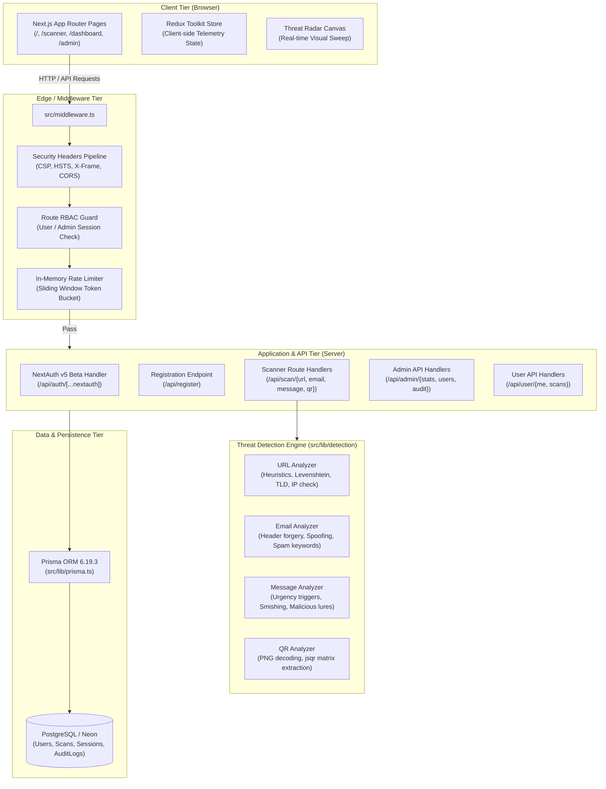
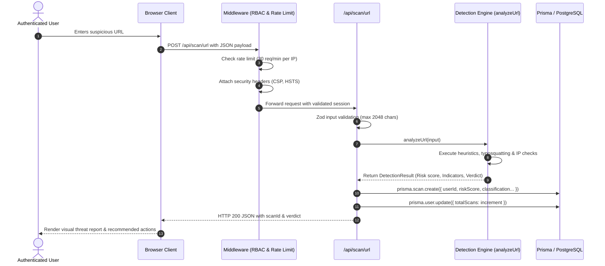

# THREATLY — System Architecture & Design Documentation

THREATLY is a modular, high-performance cybersecurity threat detection platform architected using modern full-stack web standards. This document details the technical architecture, data flows, core components, and security boundaries of the application.

---

## 1. Architectural Overview

The application follows an enterprise Next.js App Router architecture with strict separation between presentation, business logic, heuristic threat detection engines, and data persistence.

---

## 2. Component Layers & Responsibilities

### 2.1 Client Presentation Layer
- **Framework:** Next.js 16.4.6 with React 19 and Tailwind CSS 4.
- **State Management:** Redux Toolkit (`src/store/index.ts`) coordinates active scanner tabs, real-time scan results, and UI telemetry.
- **Visual Intelligence:**
  - `ThreatRadar.tsx`: Canvas-rendered radar displaying live telemetry sweeps with low-power client-side hydration.
  - `BinaryRain.tsx` & `BackgroundEffects.tsx`: Cyber-aesthetic canvas animations respecting `prefers-reduced-motion`.
  - `ScannerTabs.tsx`: Tabbed multi-vector scanner interface with input validation and instant threat feedback.

### 2.2 Middleware & Security Layer (`src/middleware.ts`)
- **Execution:** Runs on all non-static asset routes.
- **Security Headers:** Injects strict Content-Security-Policy (CSP), Strict-Transport-Security (HSTS), X-Content-Type-Options (`nosniff`), X-Frame-Options (`sameorigin`), and restrictive Permissions-Policy on every response.
- **REST API Protection:** Unlike standard web frameworks that redirect API callers to login pages, THREATLY intercepts unauthenticated requests to `/api/*` and delivers machine-readable `401 Unauthorized` or `403 Forbidden` JSON payloads with full security headers.
- **CORS Isolation:** Disallows wildcard cross-origin access on credentialed routes; restricts preflight handling to same-origin and explicitly allowed origins.

### 2.3 Threat Detection Engine (`src/lib/detection/`)
The core detection engine operates autonomously on the server without mandatory external dependencies, utilizing deterministic heuristic analysis:

1. **URL Scanner (`url.ts`):**
   - Protocol validation and canonical URL normalization.
   - Private/internal IP and metadata service detection (`169.254.x.x`, `127.0.0.1`, `10.x.x.x`, etc.) to defend against SSRF vectors.
   - Suspicious top-level domain (TLD) correlation (`.xyz`, `.top`, `.click`, `.zip`, `.mov`, etc.).
   - Levenshtein distance typosquatting checks against major global financial, tech, and e-commerce brands.
   - URL shortener identification and phishing keyword density analysis.
2. **Email Analyzer (`email.ts`):**
   - Header inspection for SPF/DKIM/DMARC status strings.
   - Display name spoofing and reply-to address mismatch detection.
   - High-urgency financial fraud keyword recognition ("wire transfer", "overdue invoice", "account suspended").
   - Suspicious attachment file extension flags (`.exe`, `.scr`, `.vbs`, `.iso`, `.zip`).
3. **Message / SMS Analyzer (`message.ts`):**
   - Smishing pattern identification (OTP requests, urgent bank verification lures, package delivery alerts).
   - Embedded URL extraction and phone number formatting analysis.
   - Urgency and fear-appeal scoring algorithms.
4. **QR Code Analyzer (`qr.ts`):**
   - Base64 payload validation and size constraints (capped at ~5MB to prevent memory exhaustion).
   - Raw PNG image decoding via `pngjs`.
   - Matrix scanning and extraction using `jsqr`.
   - Recursive URL analysis on decoded string payloads.

### 2.4 Authentication & Identity Layer (`src/lib/auth.ts`)
- **Engine:** NextAuth v5 (Beta 32) using JWT session strategy.
- **Provider:** Credentials-based authentication against hashed passwords.
- **Password Security:** Salted and hashed using `bcryptjs` with 12 rounds.
- **DoS Mitigation:** Passwords strictly capped at 128 characters in Zod validation schemas to prevent bcrypt CPU exhaustion attacks.
- **Role Enforcement:** System supports `USER` and `ADMIN` roles embedded directly inside signed JWT session tokens.

### 2.5 Persistence Layer (`prisma/schema.prisma` & `src/lib/prisma.ts`)
- **ORM:** Prisma Client 6.19.3.
- **Database:** PostgreSQL (Neon Serverless Postgres).
- **Connection Model:**
  - `DATABASE_URL`: Connection-pooled URL for runtime queries.
  - `DIRECT_URL`: Non-pooled direct endpoint for migrations.
- **Isolation Protection:** `src/lib/prisma.ts` enforces `validateTestDatabaseUrl()`, which programmatically aborts connections in test mode if the database target does not contain `test` or matches production.

---

## 3. Data Flow Diagram: Threat Scan Execution

---

## 4. Key Security Controls & Design Decisions

| Control | Implementation | Purpose |
|---|---|---|
| **Content Security Policy** | Dynamic CSP in `src/middleware.ts` | Prevents Cross-Site Scripting (XSS) and unauthorized script injection. |
| **Bcrypt DoS Protection** | Zod schema constraints (`max: 128`) | Prevents CPU exhaustion attacks through arbitrarily massive password inputs. |
| **REST API 401/403 Handling** | Middleware path differentiation | Ensures API clients receive standard HTTP JSON errors rather than HTML login page redirects. |
| **Memory Isolation Guard** | `validateTestDatabaseUrl()` | Guarantees test suites never accidentally contact or mutate the production database. |
| **Payload Size Guards** | Route-level Zod schemas | Restricts scan inputs (e.g. 5MB base64 QR images, 500KB email bodies) against resource exhaustion. |
| **Sliding Rate Limiter** | `src/middleware/rate-limit.ts` | Mitigates brute-force attacks on login, registration, and scanner routes. |
