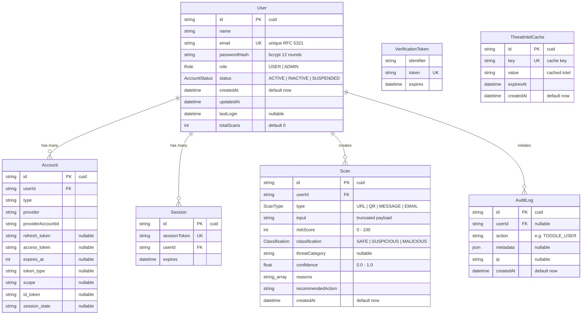

# THREATLY — Database Architecture & Schema Specification

THREATLY uses **Prisma ORM 6.19.3** paired with **PostgreSQL** (specifically optimized for serverless deployments on [Neon](https://neon.tech)). This document details the schema models, relationships, indexing strategies, and database safety protocols.

---

## 1. Entity-Relationship (ER) Diagram



---

## 2. Models & Enums Detailed

### 2.1 Enums
- **`Role`:**
  - `USER`: Standard platform user with access to unified scanner and personal scan telemetry.
  - `ADMIN`: Elevated administrator with access to the global admin dashboard, user management, and system audit logs.
- **`AccountStatus`:**
  - `ACTIVE`: Fully functional account.
  - `INACTIVE`: Temporarily disabled by admin.
  - `SUSPENDED`: Blocked due to abuse or security violation.
- **`ScanType`:** `URL`, `QR`, `MESSAGE`, `EMAIL`.
- **`Classification`:** `SAFE` (score 0–24), `SUSPICIOUS` (score 25–74), `MALICIOUS` (score 75–100).

### 2.2 Core Models
- **`User`:** Stores user credentials, role, status, and telemetry counters. Password hashes are stored with 12-round bcrypt salts.
- **`Scan`:** Contains full telemetry for every analysis performed. Indexed on `[userId]`, `[createdAt]`, `[type]`, and `[classification]` for high-performance dashboard aggregation.
- **`AuditLog`:** Records administrative and security-critical events (e.g. user deactivation, permission updates). Indexed on `[userId]` and `[createdAt]`.
- **`ThreatIntelCache`:** Key-value cache for threat intelligence lookups with expiration timestamps.

---

## 3. Database Connection Architecture

Prisma configuration in `prisma/schema.prisma` uses two distinct connection strings:

```prisma
datasource db {
  provider  = "postgresql"
  url       = env("DATABASE_URL")
  directUrl = env("DIRECT_URL")
}
```

1. **`DATABASE_URL` (Connection Pooled):**
   - Utilized by `@prisma/client` at runtime.
   - Connects to Neon's PgBouncer connection pooler (`-pooler.region.neon.tech`).
   - Ensures serverless Next.js functions do not exhaust database connection limits.
2. **`DIRECT_URL` (Direct Connection):**
   - Utilized exclusively during schema migrations.
   - Bypasses connection poolers to support transactional DDL statements (`CREATE TABLE`, `CREATE INDEX`).

---

## 4. Migration & Schema Workflow

### Applying Migrations to Development Database
When setting up locally or running migrations against a test database:

```powershell
# Create and apply new migrations based on schema changes
npx prisma migrate dev

# Generate fresh TypeScript client definitions
npx prisma generate
```

### Applying Migrations to Production
In staging and production environments, always apply migrations using:

```powershell
npx prisma migrate deploy
```

> [!CAUTION]
> **STRICT DATABASE SAFETY RULES:**
> - **NEVER** run `npx prisma db push` against a production database.
> - **NEVER** run `npx prisma migrate reset` against a production database.
> - Always verify that your current `.env` connection strings point to the intended target before executing migration commands.

---

## 5. Test Database Isolation Safeguards

To prevent accidental data corruption or loss in production, `src/lib/prisma.ts` enforces `validateTestDatabaseUrl()`:

```typescript
export function validateTestDatabaseUrl(testUrl?: string, prodUrl?: string): string {
  if (!testUrl || testUrl.trim() === "") {
    throw new Error("[DATABASE_ISOLATION_VIOLATION] In test mode, TEST_DATABASE_URL must be explicitly defined.");
  }
  if (prodUrl && testUrl.trim() === prodUrl.trim()) {
    throw new Error("[DATABASE_ISOLATION_VIOLATION] TEST_DATABASE_URL is identical to production DATABASE_URL!");
  }
  // Enforces that database name must include 'test'
  if (!dbName.toLowerCase().includes("test")) {
    throw new Error("[DATABASE_ISOLATION_VIOLATION] Target database does not contain 'test'. Refusing connection.");
  }
  return testUrl;
}
```

This ensures that automated tests run in complete isolation and cannot mutate or connect to the production database under any circumstances.
